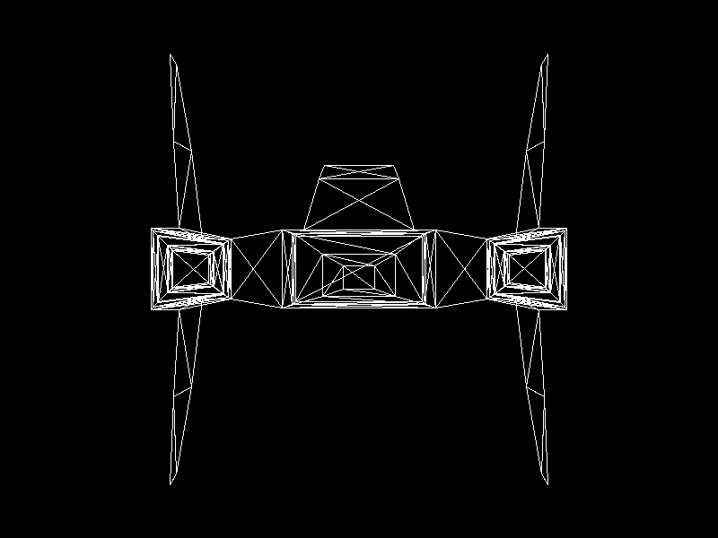

# Lab 4 - Carga de modelos

Proyecto 1, parte 1: cargar un modelo OBJ y dibujar todos sus triángulos con nuestro propio renderer en Rust. Raylib solo se usa para abrir la ventana y mostrar la imagen que genera el framebuffer; no se usan sus funciones para cargar ni dibujar modelos 3D.

## Resultado



## Cómo correrlo

```
cargo run --release
```

El programa carga `models/nave.obj`, imprime cuántos vértices y triángulos tiene, guarda la captura en `images/nave.png` y abre una ventana con el modelo.

## Cómo funciona

```
Archivo OBJ -> Vértices + índices -> Triángulos -> Líneas -> Píxeles -> Pantalla
```

1. **Carga del OBJ** (`src/obj.rs`). Cada línea `v` se guarda como un vértice y cada línea `f` como tres índices. Se toma solo el índice del vértice (`4//1` o `4/2/1` dan `4`), se pasa de base 1 a base 0 y las caras con más de tres vértices se dividen en triángulos.
2. **Recorrido del modelo** (`src/main.rs`). Por cada triángulo se obtienen sus tres índices, se buscan los tres vértices correspondientes y se construye un `Triangle`.
3. **Coordenadas de pantalla.** Por ahora solo se usan las componentes `x` y `y`. Se escalan para que el modelo ocupe el 80 % de la ventana sin deformarse, se trasladan para que quede centrado y se invierte `y` porque en pantalla crece hacia abajo. Por eso la nave se ve de frente y sin perspectiva.
4. **Dibujo** (`src/triangle.rs`, `src/line.rs`). Se usa la función `triangle` del laboratorio anterior en modo contorno, que dibuja sus tres lados con Bresenham sobre el framebuffer.

## Modelo

`models/nave.obj`: nave hecha en Blender, con 168 vértices y 332 triángulos.
